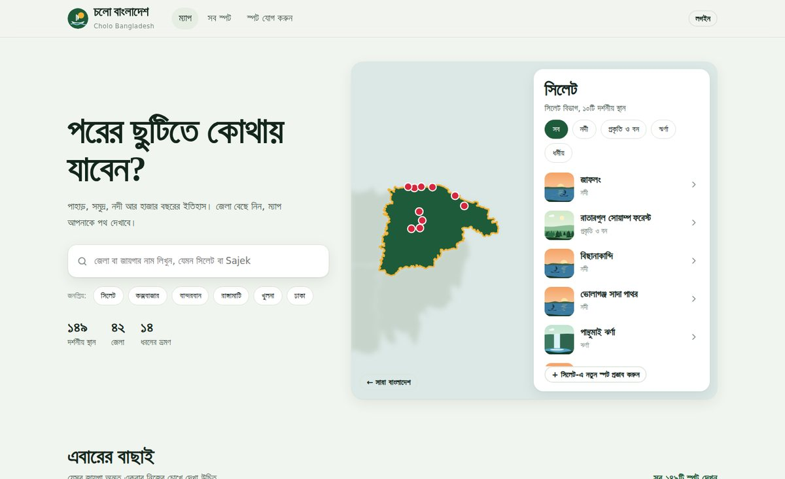
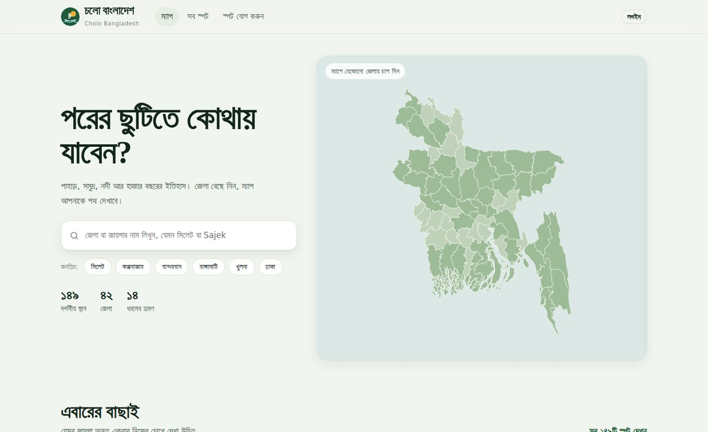
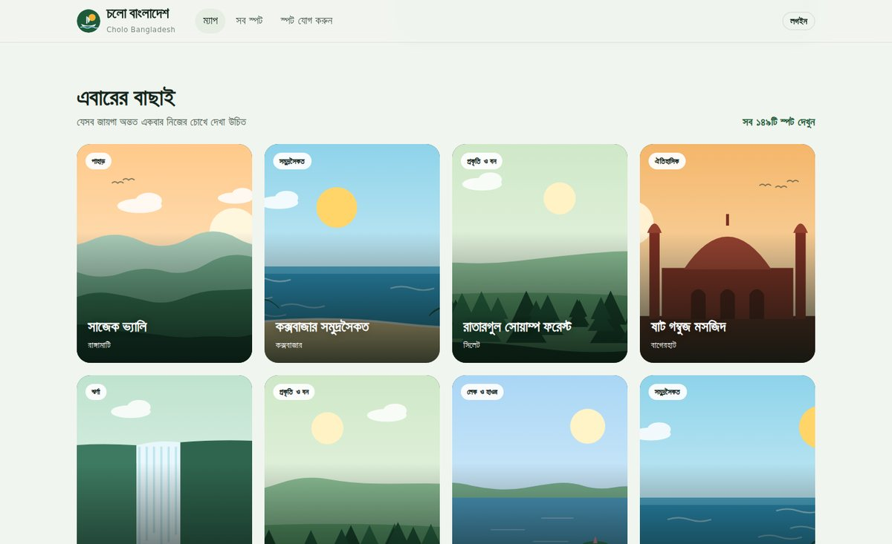
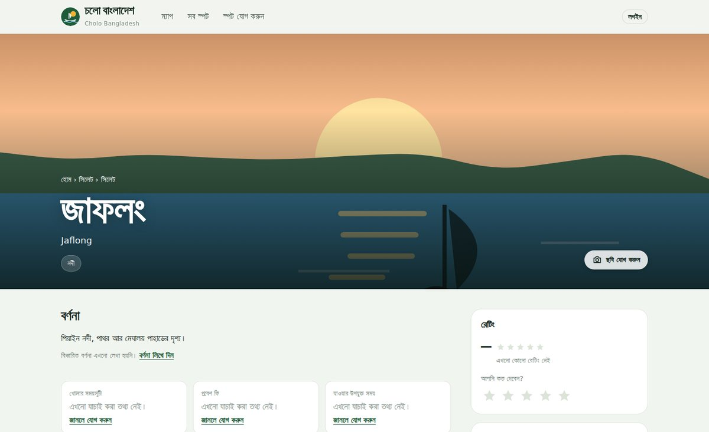
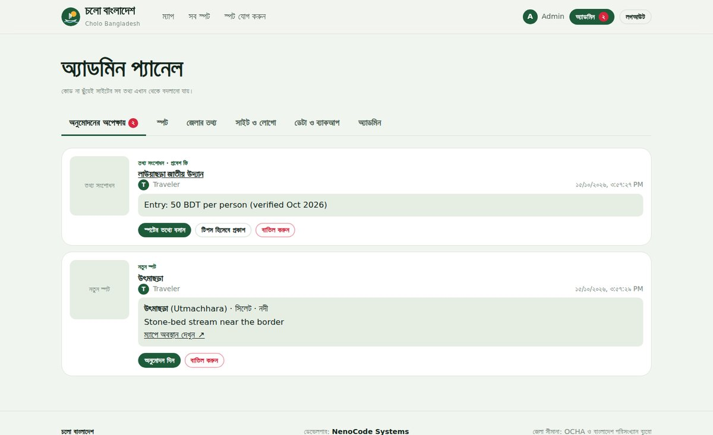
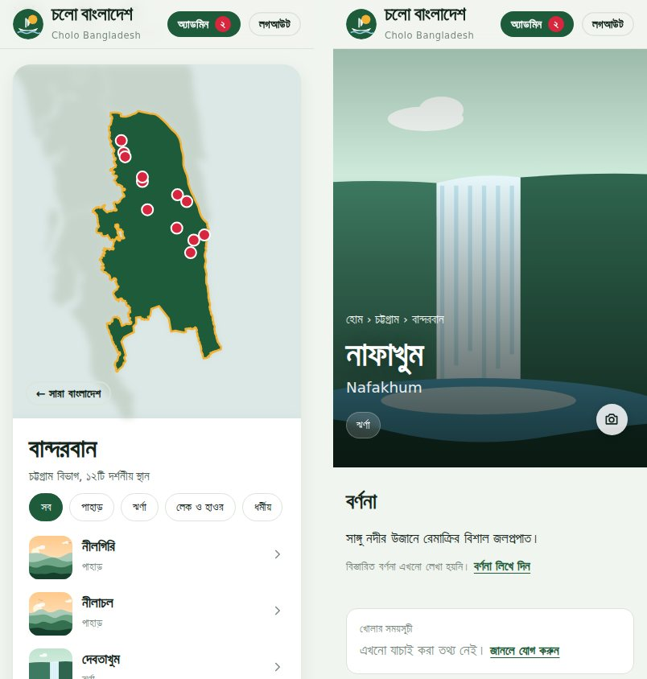

<div align="center">


# চলো বাংলাদেশ · Cholo Bangladesh

**An interactive, community-built travel guide to Bangladesh's tourist spots: pick a district on the map, explore its places, and plan the trip.**

[](LICENSE)
[](https://pages.github.com/)
[](https://firebase.google.com/)
[](#tech-stack)

[**🌐 Live site**](https://YOUR-USERNAME.github.io/cholo-bangladesh/) · [**📖 Setup guide (বাংলা)**](SETUP.md) · [**🐞 Report an issue**](../../issues)



</div>

---

## About

**Cholo Bangladesh** ("Let's go, Bangladesh") brings the country's hills, beaches, rivers, forests and thousand-year-old heritage sites into one Bangla-first website. Search or click a district, and the rest of the country blurs away while that district zooms in with every spot pinned. Each spot has its own page with how to get there, where to stay, live weather, photos and ratings.

The content grows with its visitors: travellers can add photos, correct details or suggest new places, and admins review everything before it goes live.

**149 spots · 42 districts · 8 divisions · 14 kinds of trips**, and counting.

## Features

**For travellers**
- 🗺️ **District-focus map**: search in Bangla or English (even old spellings like *Comilla* or *Chittagong*), and the chosen district zooms in with its spots pinned
- 📍 **A page for every spot**: description, opening hours, entry fee, best time to visit, and how to get there by bus, train, launch or air, plus the last leg from the district town
- 🏨 **Where to stay**, district-level travel tips, and safety notices where they matter (e.g. Bandarban's restricted areas)
- 🌤️ **Live weather** and a three-day forecast for every spot
- ⭐ **Ratings**, a photo and video gallery, and traveller tips
- 📱 Fully responsive, with automatic light and dark mode

**For contributors** (after a quick email sign-up)
- 📷 Add photos straight from any card or spot page
- ✏️ Fill in missing details such as fees and opening hours, or correct outdated ones
- ➕ Suggest a new spot by clicking its location on a map
- Everything goes to an **admin approval queue** first

**For admins** (email and password login)
- ✅ Approve or reject every submission in one place
- 🛠️ Edit **any** spot, district guide, homepage text, announcement banner or featured list, with no code changes
- 🖼️ Set cover photos and **change the site logo and name** from the dashboard
- 👥 Add or remove other admins
- 💾 **Export and backup**: merge all edits into the JSON files on GitHub, which keeps the free Firebase quota nearly untouched

## Screenshots

| Home | Featured places |
| :---: | :---: |
|  |  |
| **Spot page** | **Admin approval queue** |
|  |  |

<p align="center"></p>

## Tech stack

| Layer | What it uses |
| --- | --- |
| Frontend | Plain HTML, CSS and JavaScript ES modules, with **no framework and no build step** |
| Maps | [D3.js](https://d3js.org/) for the district map; [Leaflet](https://leafletjs.com/) + OpenStreetMap for picking locations |
| Auth & database | [Firebase](https://firebase.google.com/) Authentication (email/password) + Cloud Firestore |
| Images & video | [Cloudinary](https://cloudinary.com/) (optional; falls back to compressed images in Firestore) |
| Weather | [Open-Meteo](https://open-meteo.com/) (free, no API key) |
| Hosting | GitHub Pages |
| Fonts | Hind Siliguri, Noto Serif Bengali |

### Built to stay on the free tier

- **Base data is static.** All spots come from JSON files in `data/`, served by GitHub Pages, so they cost no Firebase reads. Firestore stores only admin edits, photos, tips, ratings and submissions.
- **Ratings cost one read.** Totals live in a single document, however many people rate. The security rules check that each user changes the totals only by their own rating.
- **Offline cache.** Firestore's persistent cache means returning visitors download only what changed.
- **Periodic export.** Admins fold edits back into the JSON files, so Firestore stays nearly empty and GitHub always holds an up-to-date backup.

## Getting started

```bash
git clone https://github.com/YOUR-USERNAME/cholo-bangladesh.git
cd cholo-bangladesh
npx serve        # or: python -m http.server 8000
```

Open the local address in a browser. With no configuration the site runs in **demo mode**: everything is browsable, while login and contributions stay disabled until Firebase is connected.

To go live, you need four steps, all on free plans:

1. Publish the repo with **GitHub Pages**
2. Create a **Firebase** project, enable Email/Password sign-in and Firestore, and paste `firestore.rules`
3. Put your Firebase config and admin email in [`js/config.js`](js/config.js)
4. *(Optional)* Add a **Cloudinary** unsigned upload preset for faster images and video uploads

👉 **Every step is explained in detail, in Bangla, in [SETUP.md](SETUP.md).**

## Project structure

```
├── index.html, spots.html, spot.html      Public pages
├── add-spot.html, login.html               Contributor pages
├── admin.html, edit-spot.html              Admin pages
├── css/style.css                           All styles
├── js/
│   ├── config.js                           ★ Site name, logo, Firebase, admin email, Cloudinary
│   ├── backend.js                          Firebase auth + Firestore wrapper
│   ├── data.js                             Static data + live edits, ratings, export
│   ├── ui.js, map.js, picker.js            Shared UI, district map, location picker
│   ├── contribute.js, upload.js, form.js   Submissions, uploads, form helpers
│   ├── page.js                             Page bootstrap
│   └── pages/                              One script per page
├── data/                                   spots.json, district-info.json, districts.geojson
├── assets/logo.svg                         Replace to rebrand
├── docs/screenshots/                       Images used in this README
├── firestore.rules                         Database security rules
├── SETUP.md                                Full setup guide (Bangla)
└── LICENSE
```

## Customising

- **Logo and name:** upload them in *Admin panel → Site & logo*, or replace `assets/logo.svg` and edit `SITE` in `js/config.js`.
- **Content:** everything visible on the site can be edited from the admin panel.
- **Developer credit:** set `SITE.developer` and `SITE.developerUrl` in `js/config.js`.

## Contributing

- **Know a place, have a photo, or spotted a wrong fee?** Add it directly on the website; no GitHub account needed.
- **Code contributions** are welcome: open an issue to discuss, then send a pull request. Please keep the no-build, plain-JavaScript approach.

## Data sources & credits

- District boundaries: **OCHA** and **Bangladesh Bureau of Statistics**, via the Humanitarian Data Exchange
- Verified spot coordinates: **© OpenStreetMap contributors**, under the [ODbL](https://www.openstreetmap.org/copyright)
- Weather: **[Open-Meteo](https://open-meteo.com/)**, CC BY 4.0
- Opening hours and entry fees are left blank until verified, because they change often. Visitors are invited to fill them in.

## License

The code is released under the **[MIT License](LICENSE)**. The third-party data listed above keeps its own licence.

---

<div align="center">

Developed by **NenoCode Systems**

<sub>ভ্রমণকারীদের হাতে গড়া বাংলাদেশের দর্শনীয় স্থানের তালিকা</sub>

</div>
